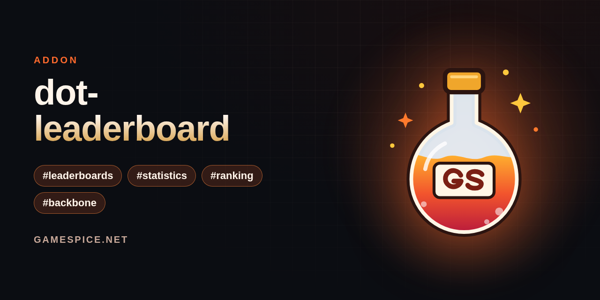

[](https://moddingcommunity.com/a/23-gs-leaderboard)

Leaderboards and player statistics for any Godot game, plus the path from a game server to the TMC website's leaderboards.

gs-leaderboard is a [GameSpice](https://gamespice.net) addon, MIT licensed, built with Claude Code and tested by a headless suite (`examples/leaderboard_selftest.tscn`). The games in [Zee's Games](https://zeesgames.com) are built on the GameSpice addons and run on live servers, and several of them post their boards through this one.

## What you get

A board orders one number per player within a scope you choose, such as map, track and style. "Fastest time on surf_beginner", "most kills this week" and "highest score" are one thing with different settings.

- **Boards** with four orderings (`TIME`, `SCORE`, `POINTS`, `PENALTY`) and display that knows a time from a score.
- **Ranks.** Ties share a rank (1, 2, 2, 4) in every store.
- **Player statistics:** counters, bests and lowests, and any counter can become a board.
- **Stores:** in memory, or `GSLeaderboardStoreSql` for SQLite, Postgres and MySQL/MariaDB through [GameSpice SQL](https://github.com/gamespice-platform/sql).
- **A reporter** that batches submissions to the TMC backbone and keeps its queue through an outage.

## Install

Copy `addons/gs_leaderboard/` and [GameSpice Core](https://github.com/gamespice-platform/core)'s `addons/gs_core/` into your project and enable gs-leaderboard in **Project > Project Settings > Plugins**. gs-auth, gs-timer, gs-server and gs-sql are optional and never named in the source.

## Use

```gdscript
var boards := GSLeaderboardManager.new()
boards.store = GSLeaderboardStoreMemory.new()
add_child(boards)

var fastest := GSLeaderboardDef.make(&"fastest", GSLeaderboardDef.Kind.TIME)
fastest.display_name = "Fastest time"
fastest.publish = true                # opt in to the site leaderboard
boards.define(fastest)

# one definition, one board per (map, track, style)
await boards.submit(
    &"fastest",
    {"map": "surf_beginner", "track": "0", "style": "normal"},
    player_id, player_name, run.time()
)

var page := await boards.page(&"fastest", {"map": "surf_beginner", "track": "0", "style": "normal"})
for entry in page.value:
    print("%d. %s %s" % [entry.rank, entry.player_name, fastest.format_value(entry.value)])
```

### Statistics

```gdscript
var session := GSStatSet.new()
session.add(&"jumps", stats.jumps)
session.set_best(&"top_speed", stats.max_speed)
await boards.add_stats(player_id, session)

# any counter can become a board
await boards.publish_stat(&"most_jumps", {}, player_id, player_name, &"jumps")
```

### A database

```gdscript
var store := GSLeaderboardStoreSql.new(driver)   # any gs-sql driver
await store.open()                                # creates or migrates its two tables
boards.store = store

await boards.submit_async(&"fastest", scope, player_id, player_name, run.time())
var page := await boards.page_async(&"fastest", scope)
```

Use the `_async` forms (`submit_async`, `page_async`, `entry_for_async`) with a database store. The plain forms refuse a store that has to wait. `add_stats`, `stats_for` and `publish_stat` are always awaited. Table names are the `entries_table` and `stats_table` settings (defaults `gs_leaderboard_entries` and `gs_leaderboard_stats`). Counters are added inside the database, so two servers sharing it do not lose each other's updates.

### Reporting to the website

```gdscript
boards.report_to_backbone = true
boards.reporter.client = backbone_client   # gs-auth's GSBackboneClient
```

This needs the `LEADERBOARD_WRITE` scope on a server or app integration. Entries are queued and sent in batches, and the queue survives an outage.

## Board definitions file

`tools/export_site_defs.gd` writes your boards as the website's `gs-leaderboard-defs` JSON, for the dashboard import or a deploy. Run it from the game project.

| Option | Meaning |
| --- | --- |
| `--source` | Script with the static method that returns an array of `GSLeaderboardDef`. |
| `--method` | The method name. |
| `--out` | Output file (default `deployment/leaderboard-defs.json`). |
| `--game` | Pin the site app id (unset by default). |
| `--check` | Exit 1 if the file is stale. |

A board is identified by `key` plus `scope`. Importing merges, and boards the file does not mention are kept with their entries.

## More

[docs/](docs/README.md) explains the design choices.

## Test

```bash
godot --headless --path . --import
godot --headless --path . res://examples/leaderboard_selftest.tscn

# the SQL store against real SQLite, Postgres and MariaDB (gs-sql linked in addons/)
../gs-sql/tools/test_live.sh . res://examples/leaderboard_sql_live.tscn
```

## Used by

### Zee's Games

Zee's Games is a collection of games I made on GameSpice, for demonstration and for fun. They show what the platform can do, and they run on live servers you can join. Anybody can create games on GameSpice, and each addon is its own repository and can be used separately from the games and from the rest of GameSpice.

These games vendor it:

- [Fatal Contact](https://zeesgames.com/fatal-contact) - defines and submits its boards
- [Airdrift](https://zeesgames.com/airdrift) - run times per map, track and style
- [Playlot](https://zeesgames.com/playlot) - submits entries to its boards
- [Hungario](https://zeesgames.com/hungario) - defines and submits its boards
- [Zombie Zone](https://zeesgames.com/zombie-zone)

The whole collection is at [zeesgames.com](https://zeesgames.com).

## Licence

MIT. See [LICENSE](LICENSE).
